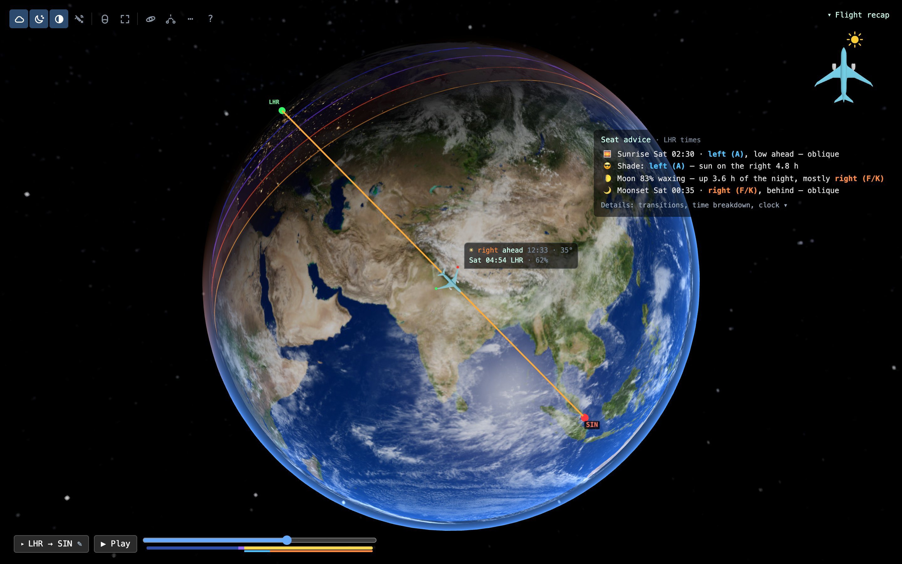
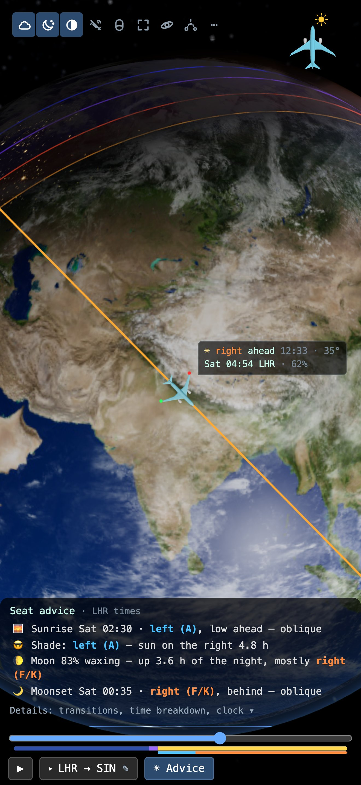

# 3D Earth Flight Viewer

An interactive 3D Earth in the browser that draws great-circle flight routes
between any two IATA airports, animates a plane along the route, and shows
where the sun is relative to the plane at every point (clock direction,
elevation, day / twilight / night).

<p align="center">
  
  
</p>
<p align="center"><sub>London → Singapore overnight, on a laptop (1440×900) and a phone (440×956, iPhone Pro Max size)</sub></p>

**Live demo:** <https://brew-your-own.github.io/3d-earth-sunflight/>

## Why I built this

[sunflight.org](https://sunflight.org) — the site went dark recently, and
I wanted to see if I could build something similar quickly with the latest
Claude Code. This was really a personal project to play with the technology
outside my normal wheelhouse (I'm normally more of a backend guy). It turns
out it only took a couple of hours to get this done, which is incredible.

This is not meant to be 100% reliable: the results look credible but I haven't
verified them extensively. It matches closely what [flightside.app](https://flightside.app)
does on the few tests I ran. I built it to scratch an itch — it is only a fun toy.

## Features

- Textured Earth (day map, night lights, normal map, clouds) on a tilted axis,
  with a Milky Way starfield background
- Great-circle route between two airports (~9 000 IATA codes built in), with
  autocomplete that matches IATA code, city, or airport name
- Optional waypoints — piecewise great-circle through any number of extra
  airports, useful for simulating non-direct trajectories
- IATA labels on the start, end, and each waypoint marker
- Plane animated along the route using slerp interpolation
- Real subsolar-point computation (NOAA formula, ~0.01° accuracy) so the sun
  direction is correct for the actual flight time
- Live readout floating next to the plane: sun side, clock direction and
  elevation, local time, progress — click it for position, altitude, speed
  and distance
- Seat advice: which side gets the shade, sunrise / sunset / moon / aurora
  per window (click a line to jump there and look out that window)
- Recap of day / twilight / night and sun left / right transitions, in the
  departure, arrival, UTC or under-the-plane timezone — the current segment
  is highlighted during playback
- Window-seat and cockpit views (`W`, full screen with `F`)
- Real GPS tracks: drop a KML / KMZ / GPX file on the globe to replay it
- Timezone + UTC offset shown next to each datetime input; arrival time can be
  entered as a datetime or as a duration (toggle)
- Example routes and shareable URL parameters (`?from=&to=&via=&dep=&arr=`)
- Icon toolbar (each button names its hotkey; `?` lists them all): clouds
  (`C`), night lights (`N`), twilight bands (`T`), live NASA GIBS satellite
  imagery (`L`), window view, drag mode, and `G` to center on the route / the
  plane (your location when no route is loaded); day/night contrast in the
  "⋯" menu
- Uncluttered by default: the route form folds into a `JFK → HND ✎` summary
  once a flight plays and the recap stays closed until you open it. On a
  phone, playback sits in a bottom dock and panels open as sheets above it

## Run it locally

```bash
npm install
npm run dev      # http://localhost:5173 — also served on the LAN for phone testing
```

## Build

```bash
npm run build    # chunked production build → dist/  (suitable for web hosting)
npm run package  # single self-contained dist/index.html (~5 MB, double-clickable)
```

The single-file build inlines all textures and the airport database as base64,
so the resulting HTML runs from disk with no server and no network (except for
the optional live-satellite overlay).

## Credits & license

- [CREDITS.md](CREDITS.md) — data sources, textures, inspiration
- [LICENSE](LICENSE) — Apache-2.0 (code) + CC BY 4.0 (bundled Earth textures)
